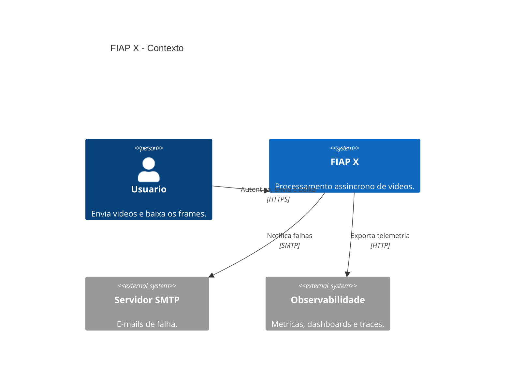
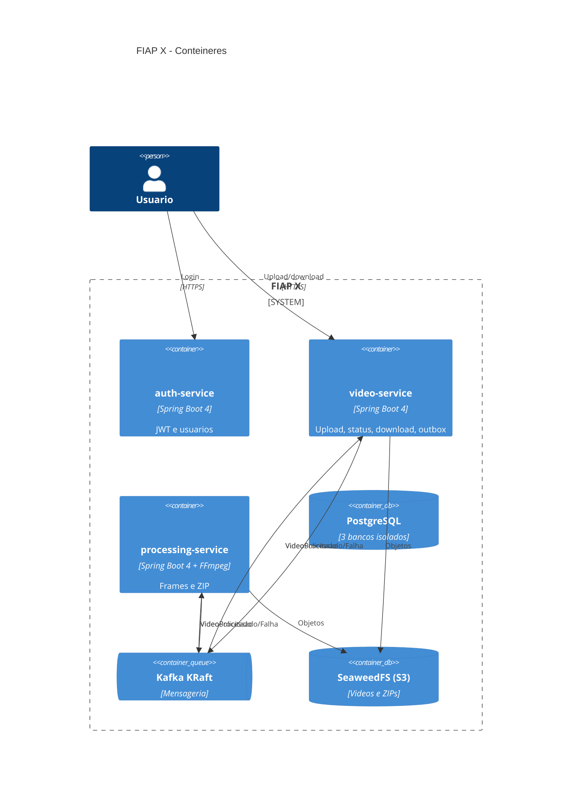
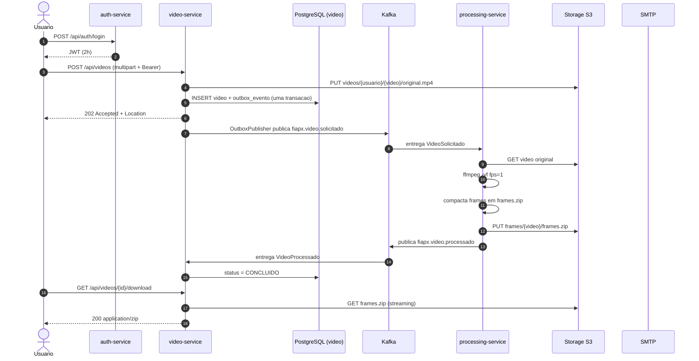

# FIAP X - Arquitetura da Fase 5

## 1. Visao geral

O FIAP X e uma plataforma de **processamento assincrono de videos**. O usuario se autentica, envia um video, acompanha o status do processamento e, ao final, baixa um arquivo ZIP com os frames extraidos (1 frame por segundo, como no projeto original em Go).

A Fase 5 substitui a implementacao monolitica em Go por **tres microsservicos Java 21 / Spring Boot 4**, mantendo o mesmo fluxo funcional e elevando os requisitos de persistencia, escalabilidade, resiliencia e observabilidade.

| Servico | Porta | Responsabilidade |
|---|---|---|
| `auth-service` | 8081 | Cadastro, login, emissao e validacao de JWT |
| `video-service` | 8082 | Upload, status, download, outbox transacional e notificacao por e-mail |
| `processing-service` | 8083 | Consumo do pedido, extracao de frames com FFmpeg, ZIP e publicacao do resultado |

## 2. Requisitos atendidos

| Requisito | Como foi atendido |
|---|---|
| Processar varios videos simultaneamente | Topico `fiapx.video.solicitado` com 3 particoes, consumer group com 2+ replicas e HPA no `processing-service` |
| Nao perder requisicoes em picos | **Transactional outbox** no `video-service`: video e evento sao gravados na mesma transacao; publicacao assincrona com retry |
| Autenticacao usuario/senha | `auth-service` com BCrypt (custo 12) e JWT HS256 |
| Listagem de status por usuario | `GET /api/videos` filtra por `usuario_id` extraido do JWT |
| Notificacao de erro por e-mail | Evento `VideoFalha` -> tabela `notificacao` -> `NotificacaoScheduler` com SMTP e retentativa |
| Persistencia | PostgreSQL com **um banco por servico** e Flyway |
| Arquitetura escalavel | Servicos stateless, Kafka, object storage, HPA e Virtual Threads |
| Versionamento no GitHub | Quatro repositorios: tres servicos + documentacao/infra |
| Testes automatizados | 37 testes (auth) + 104 (video) + 48 (processing), JaCoCo >= 85% |
| CI/CD | GitHub Actions com build, testes, cobertura, SonarCloud e build da imagem |
| Docker e Kubernetes | Dockerfiles multi-stage, Docker Compose completo e manifests k8s |
| Kafka/RabbitMQ | Apache Kafka em modo KRaft |
| PostgreSQL + cache/alternativa | PostgreSQL + object storage S3-compativel (SeaweedFS local, S3 em producao) |
| Prometheus + Grafana | Actuator/Prometheus, scrape config e dashboard provisionado |
| Documentacao e scripts de criacao | Este documento, C4 em `docs/c4`, Flyway e `infra/postgres/init` |

## 3. Decisoes arquiteturais

| ID | Decisao | Justificativa |
|---|---|---|
| ADR-01 | Tres microsservicos independentes | Isola autenticacao, API e processamento pesado; permite escalar o processamento separadamente |
| ADR-02 | Database per service | Evita acoplamento por schema e permite evolucao independente |
| ADR-03 | Kafka KRaft | Mensageria durável, particionada e sem Zookeeper |
| ADR-04 | Transactional outbox | Garante que nenhum pedido de processamento seja perdido entre banco e broker |
| ADR-05 | Idempotencia via `evento_processado` | Consumidores podem reprocessar sem duplicar efeitos |
| ADR-06 | Object storage S3-compativel atras de `StoragePort` | Producao usa S3; ambiente local usa SeaweedFS (as imagens publicas do MinIO foram descontinuadas); testes usam adapter em memoria |
| ADR-07 | JWT HS256 com segredo compartilhado | Simplicidade operacional; auth-service e o unico emissor |
| ADR-08 | Snapshot do e-mail no `video-service` | Notificar falha sem dependencia sincrona do auth-service |
| ADR-09 | Spring Boot 4 + Java 21 + Virtual Threads | Melhor throughput para I/O sem complexidade de programacao reativa |
| ADR-10 | Flyway + `ddl-auto: validate` | Schema versionado e validado na inicializacao |

## 4. Diagramas C4

Arquivos Mermaid em [`docs/c4`](./c4):

- `01-contexto.mmd` - pessoas, sistema e sistemas externos
- `02-conteineres.mmd` - servicos, bancos, Kafka, storage S3 e observabilidade
- `03-componentes-auth.mmd`
- `03-componentes-video.mmd`
- `03-componentes-processing.mmd`
- `04-implantacao.mmd` - Docker Compose local e k3s
- `05-codigo-outbox.mmd` - fluxo da outbox transacional

### 4.1 Contexto



### 4.2 Conteineres



## 5. Fluxo principal



Em caso de falha, o `processing-service` publica `fiapx.video.falha`. O `video-service` marca o video como `ERRO`, grava uma linha em `notificacao` e o scheduler envia o e-mail com retentativa (5 tentativas por padrao).

## 6. Modelo de dados

Scripts versionados com Flyway em cada servico. O ambiente local tambem cria os tres bancos via [`infra/postgres/init/01-create-databases.sql`](../infra/postgres/init/01-create-databases.sql).

### 6.1 `fiapx_auth`

| Tabela | Principais colunas |
|---|---|
| `usuario` | `id` (UUID), `nome`, `email` (unique), `senha_hash`, `role` (`USER`/`ADMIN`), `ativo`, `criado_em`, `atualizado_em` |

### 6.2 `fiapx_video`

| Tabela | Finalidade |
|---|---|
| `video` | Agregado do video: status, chaves no storage, erro e timestamps |
| `outbox_evento` | Eventos pendentes/enviados para o Kafka |
| `evento_processado` | Idempotencia dos eventos consumidos |
| `notificacao` | Fila de e-mails de falha com tentativas |

Estados do video: `PENDENTE -> PROCESSANDO -> CONCLUIDO` ou `ERRO`.

### 6.3 `fiapx_processing`

| Tabela | Finalidade |
|---|---|
| `processamento` | Estado do processamento por `video_id`, total de frames e erro |
| `evento_processado` | Idempotencia do pedido consumido |

Estados do processamento: `RECEBIDO -> PROCESSANDO -> CONCLUIDO` ou `FALHA`.

## 7. Mensageria

| Topico | Produtor | Consumidor | Conteudo |
|---|---|---|---|
| `fiapx.video.solicitado` | video-service | processing-service | `eventId`, `videoId`, `usuarioId`, `nomeArquivo`, `contentType`, `tamanhoBytes`, `storageKey`, `solicitadoEm` |
| `fiapx.video.processado` | processing-service | video-service | `eventId`, `videoId`, `framesZipKey`, `totalFrames`, `processadoEm` |
| `fiapx.video.falha` | processing-service | video-service | `eventId`, `videoId`, `motivo`, `ocorridoEm` |

Garantias:

- **Outbox transacional** no `video-service`: o evento e gravado junto com o video.
- **Idempotencia** nos dois consumidores pela tabela `evento_processado`.
- **Retry e DLT**: `DefaultErrorHandler` com `FixedBackOff` e `DeadLetterPublishingRecoverer`; apos esgotar, a mensagem vai para `<topico>.DLT`.
- `processing-service` usa `max-poll-records=1` e `max.poll.interval.ms=900000` para processamentos longos.
- Falha ao publicar o resultado propaga a excecao para acionar retry/DLT, evitando perda silenciosa.

## 8. Seguranca

- Senhas com **BCrypt custo 12**.
- JWT **HS256**, issuer `fiapx-auth`, validade de 2 horas, claims `sub`, `nome`, `email` e `role`.
- `auth-service` emite o token; `video-service` valida com o mesmo segredo (`JWT_SECRET`).
- `video-service` e stateless: `SecurityFilterChain` com `SessionCreationPolicy.STATELESS`, CSRF desabilitado e CORS configuravel.
- Roles `USER` e `ADMIN`; `ADMIN` pode consultar videos de qualquer usuario.
- `processing-service` nao expoe API de negocio, apenas actuator interno.

## 9. Escalabilidade e resiliencia

- Servicos stateless podem ser replicados horizontalmente.
- Kafka particiona por `videoId`, permitindo processamento concorrente e ordenado por video.
- HPA de 2..6 (auth), 2..8 (video) e 2..10 (processing) com alvo de 70% de CPU.
- Virtual Threads habilitadas no Spring Boot.
- `processing-service` usa diretorio temporario isolado por execucao e o remove em `finally`.
- Timeout configuravel do FFmpeg (`FFMPEG_TIMEOUT_SECONDS`, padrao 600s).
- Retentativas: outbox (ate 10 tentativas), e-mail (5 por padrao), consumidores (2 tentativas + DLT).
- Shutdown gracioso no `processing-service` para concluir o processamento em andamento.

## 10. Observabilidade

| Recurso | Endpoint/Config |
|---|---|
| Health | `/actuator/health`, `/actuator/health/liveness`, `/actuator/health/readiness` |
| Metricas | `/actuator/prometheus` |
| Prometheus | [`infra/prometheus/prometheus.yml`](../infra/prometheus/prometheus.yml) |
| Dashboard | [`infra/grafana/dashboards/fiapx-overview.json`](../infra/grafana/dashboards/fiapx-overview.json) |
| Tracing | Zipkin em `ZIPKIN_ENDPOINT`, sampling 1.0 em desenvolvimento |

O dashboard cobre requisicoes por segundo, latencia p95, erros 4xx/5xx, lag de consumidores, heap JVM e threads.

## 11. Como executar localmente

Pre-requisitos: Docker 24+ e Docker Compose v2.

```bash
cd fase-5
docker compose up --build -d
docker compose ps
```

| Servico | URL |
|---|---|
| auth-service | http://localhost:8081 |
| video-service | http://localhost:8082 |
| processing-service (actuator) | http://localhost:8083/actuator/health |
| Swagger auth | http://localhost:8081/swagger-ui.html |
| Swagger video | http://localhost:8082/swagger-ui.html |
| SeaweedFS Filer UI | http://localhost:8888 |
| MailHog | http://localhost:8025 |
| Zipkin | http://localhost:9411 |
| Prometheus | http://localhost:9090 |
| Grafana | http://localhost:3000 (`admin` / `fiapx12345`) |

Kafka:

- Dentro do Compose: `kafka:9092`
- A partir do host: `localhost:9094`

Smoke test rapido:

```bash
curl -s -X POST http://localhost:8081/api/auth/register \
  -H 'Content-Type: application/json' \
  -d '{"nome":"Maria","email":"maria@fiapx.com","senha":"senha1234"}'

TOKEN=$(curl -s -X POST http://localhost:8081/api/auth/login \
  -H 'Content-Type: application/json' \
  -d '{"email":"maria@fiapx.com","senha":"senha1234"}' | jq -r .accessToken)

curl -s -X POST http://localhost:8082/api/videos \
  -H "Authorization: Bearer $TOKEN" \
  -F "arquivo=@video.mp4"

curl -s http://localhost:8082/api/videos -H "Authorization: Bearer $TOKEN"
```

Parar e limpar:

```bash
docker compose down
docker compose down -v   # remove volumes (bancos, storage, metricas)
```

Smoke test automatizado (cadastro, login, upload, polling e validacao do ZIP):

```bash
./scripts/smoke-test.sh video.mp4
pwsh ./scripts/smoke-test.ps1 -VideoPath .\video.mp4
```

## 12. Execucao sem Docker

```bash
# infraestrutura minima
docker compose up -d postgres kafka kafka-init storage storage-init mailhog zipkin prometheus grafana

# em cada servico
mvn -B verify
mvn spring-boot:run
```

Ajuste as variaveis de ambiente conforme a secao 13.

## 13. Variaveis de ambiente

### auth-service

| Variavel | Padrao |
|---|---|
| `DB_URL` | `jdbc:postgresql://localhost:5432/fiapx_auth` |
| `DB_USER` / `DB_PASSWORD` | `fiapx_auth_user` / `fiapx_auth_pass` |
| `JWT_SECRET` | segredo de desenvolvimento (>= 32 bytes) |
| `JWT_ISSUER` | `fiapx-auth` |
| `JWT_EXPIRATION` | `PT2H` |
| `ZIPKIN_ENDPOINT` | `http://localhost:9411/api/v2/spans` |

### video-service

| Variavel | Padrao |
|---|---|
| `DB_URL` | `jdbc:postgresql://localhost:5432/fiapx_video` |
| `DB_USER` / `DB_PASSWORD` | `fiapx_video_user` / `fiapx_video_pass` |
| `KAFKA_BOOTSTRAP_SERVERS` | `localhost:9092` |
| `KAFKA_GROUP_ID` | `fiapx-video-group` |
| `STORAGE_ENDPOINT` | `http://localhost:8333` |
| `STORAGE_ACCESS_KEY` / `STORAGE_SECRET_KEY` | `fiapx` / `fiapx12345` |
| `STORAGE_BUCKET` | `fiapx-videos` |
| `JWT_SECRET` / `JWT_ISSUER` | devem ser iguais aos do auth-service |
| `MAIL_HOST` / `MAIL_PORT` | `localhost` / `1025` |
| `MAIL_FROM` | `nao-responda@fiapx.com` |
| `MAIL_MAX_TENTATIVAS` | `5` |
| `UPLOAD_MAX_FILE_SIZE` | `500MB` |

### processing-service

| Variavel | Padrao |
|---|---|
| `DB_URL` | `jdbc:postgresql://localhost:5432/fiapx_processing` |
| `DB_USER` / `DB_PASSWORD` | `fiapx_processing_user` / `fiapx_processing_pass` |
| `KAFKA_BOOTSTRAP_SERVERS` | `localhost:9092` |
| `KAFKA_GROUP_ID` | `fiapx-processing-group` |
| `STORAGE_*` | mesmos valores do video-service |
| `FFMPEG_BINARY` | `ffmpeg` |
| `FFMPEG_FPS` | `1` |
| `FFMPEG_TIMEOUT_SECONDS` | `600` |

## 14. API

### auth-service

| Metodo | Caminho | Descricao |
|---|---|---|
| POST | `/api/auth/register` | Cadastra usuario e devolve 201 |
| POST | `/api/auth/login` | Autentica e devolve `accessToken` |
| GET | `/api/auth/me` | Dados do usuario do token |

### video-service

| Metodo | Caminho | Descricao |
|---|---|---|
| POST | `/api/videos` | Upload multipart (`arquivo`) e devolve 202 |
| GET | `/api/videos?status=&pagina=&tamanho=` | Lista paginada do usuario |
| GET | `/api/videos/{id}` | Consulta status |
| GET | `/api/videos/{id}/download` | Download do ZIP (streaming) |

Erros padronizados:

| HTTP | Codigo | Situacao |
|---|---|---|
| 400 | `ARQUIVO_INVALIDO` | Arquivo ausente, vazio, grande ou formato nao suportado |
| 401 | `NAO_AUTENTICADO` | Token ausente ou invalido |
| 403 | `ACESSO_NEGADO` | Sem permissao |
| 404 | `VIDEO_NAO_ENCONTRADO` | Video inexistente ou de outro usuario |
| 409 | `VIDEO_NAO_PROCESSADO` | Download antes da conclusao |
| 413 | `ARQUIVO_MUITO_GRANDE` | Upload acima do limite |
| 502 | `FALHA_ARMAZENAMENTO` | Storage S3 indisponivel |

## 15. Testes e qualidade

```bash
cd tc-fiapx-auth-service       && mvn -B verify
cd tc-fiapx-video-service      && mvn -B verify
cd tc-fiapx-processing-service && mvn -B verify
```

| Servico | Testes | Cobertura minima |
|---|---|---|
| auth-service | 37 | 85% linhas e branches |
| video-service | 104 | 85% linhas e branches |
| processing-service | 48 | 85% linhas e branches |

Os testes de integracao usam H2 em modo PostgreSQL, storage/email/extrator/publisher fake e Kafka desabilitado. Os testes do `DefaultProcessRunner` executam processos Java reais para validar timeout e truncamento de log.

Analise estatica: SonarCloud configurado no POM (`sonar.projectKey`, `sonar.coverage.jacoco.xmlReportPaths`) e no workflow.

## 16. CI/CD

Cada repositorio tem `.github/workflows/ci.yml` com:

1. Checkout e JDK 21 (Temurin) com cache Maven.
2. `mvn -B clean verify` (testes + JaCoCo 85%).
3. SonarCloud quando `SONAR_TOKEN` estiver configurado.
4. Publicacao do relatorio JaCoCo.
5. Build da imagem Docker.
6. Publicacao da imagem no GHCR (`ghcr.io/rtmaraujo/tc-fiapx-*`), na `main` ou via `workflow_dispatch`.

O deploy no k3s da AWS Academy e feito pelos scripts em `deploy/` (instancia EC2 com k3s, manifests de infraestrutura e aplicacao da stack). Os manifests em `k8s/` de cada servico incluem Deployment, Service, HPA, ConfigMap, Secret de exemplo e IngressRoute (Traefik).

## 17. Deploy no Kubernetes

Ambiente local (Docker Compose) e o caminho padrao de demonstracao. Para o cluster k3s na AWS Academy:

```powershell
$env:AWS_DEFAULT_REGION = 'us-west-2'
powershell -ExecutionPolicy Bypass -File .\deploy\aws\bootstrap.ps1

$env:KUBECONFIG="$HOME\.kube\fiapx-k3s.yaml"
powershell -ExecutionPolicy Bypass -File .\deploy\deploy.ps1 -PublicIp <ip-publico>
```

O `bootstrap.ps1` cria a chave SSH, o security group e a instancia `t3.large` com k3s. O `deploy.ps1` cria os secrets, aplica a infraestrutura (`deploy/k8s`) e os tres servicos, aguardando os jobs de inicializacao (bancos, topicos e bucket).

Validacao no cluster (17/11/2026): 12 pods em `Running`, smoke test E2E com ZIP de 6 frames, caminho de falha com e-mail no MailHog, Prometheus com 4 targets `up` e os 3 servicos no Zipkin. Para derrubar os recursos: `deploy/aws/teardown.ps1`.

Dependencias de infraestrutura no cluster, ja provisionadas pelos manifests de `deploy/k8s`:

- PostgreSQL com os tres bancos (`infra/postgres/init`).
- Kafka com os tres topicos (3 particoes cada).
- Object storage S3-compativel com o bucket `fiapx-videos` (SeaweedFS no Compose e no cluster).
- MailHog, Zipkin, Prometheus e Grafana.

## 18. Estrutura dos repositorios

```text
tc-fiapx-auth-service/
  src/main/java/com/fiapx/auth/{application,config,domain,infrastructure,presentation,security}
  src/main/resources/{application.yml,db/migration}
  src/test/...
  k8s/  Dockerfile  pom.xml  .github/workflows/ci.yml

tc-fiapx-video-service/
  src/main/java/com/fiapx/video/{application,config,domain,infrastructure,presentation,security}
  k8s/  Dockerfile  pom.xml  .github/workflows/ci.yml

tc-fiapx-processing-service/
  src/main/java/com/fiapx/processing/{application,config,domain,infrastructure}
  k8s/  Dockerfile  pom.xml  .github/workflows/ci.yml

tc-fiapx-docs/
  docs/ARQUITETURA-FASE5.md
  docs/c4/*.mmd
  docs/postman/*
  docs/ROTEIRO-VIDEO.md
  infra/{postgres,prometheus,grafana,kafka}
  deploy/{aws,k8s}
  scripts/{smoke-test.sh,smoke-test.ps1,publicar-github.ps1}
  docker-compose.yml
```

## 19. Limitacoes e proximos passos

- O cluster da AWS Academy usa credenciais temporarias: ao encerrar a sessao do laboratorio, a instancia e os dados deixam de existir.
- Sem interface web por decisao de escopo: a validacao e feita via Postman/Swagger.
- Possivel evolucao: refresh token, rate limiting no upload, antivirus, notificacao de sucesso por e-mail, metricas de negocio (videos processados/falhos) e DLQ monitorada.
- Para producao real, usar PostgreSQL gerenciado, Kafka gerenciado (MSK), S3 e SMTP autenticado com TLS.
